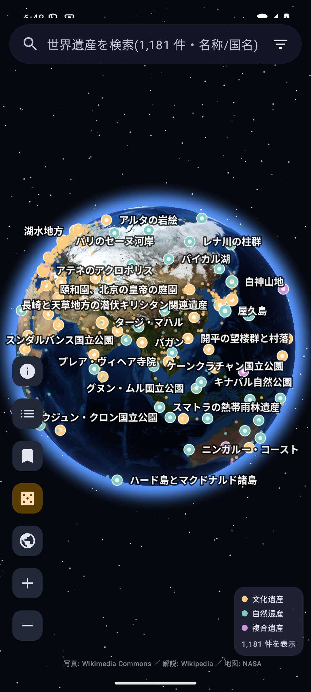
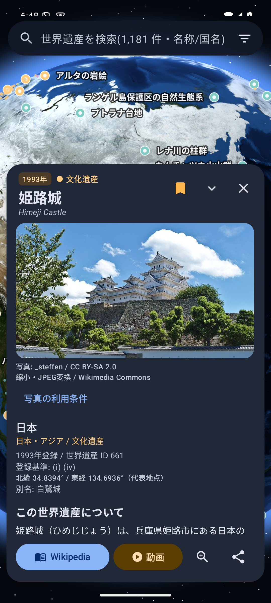
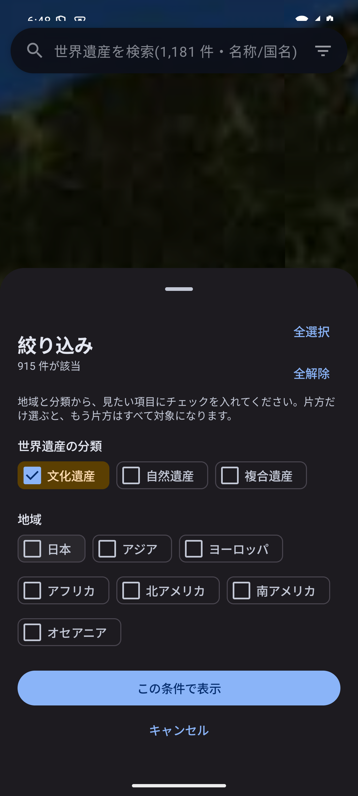

# 地球儀で見る世界遺産

世界の **1,181 件の世界遺産**を、触って回せる 3D 地球儀で巡る Android アプリです。すべてのピンに **写真・説明・出典**を同梱し、オフラインで閲覧できます。

[hatake716/animal_planet](https://github.com/hatake716/animal_planet) の地球儀・カメラ・ピン描画・Compose UI を利用して制作しています。元コードのコミットは `d220f5c3e1969872ed5e1c70be4d1a216ca9bdbd`。MIT ライセンスを保持しています。

## スクリーンショット

| 地球儀 | 写真付き詳細 | 地域・分類の絞り込み |
| --- | --- | --- |
|  |  |  |

## 機能

- OpenGL ES による 3D 地球儀。ドラッグ回転、慣性、ピンチ拡大縮小、ダブルタップ拡大。北極・南極を越えて連続して回転でき、最大拡大でも画面内のピンを選べます。
- ピンをタップして、写真、説明、国・地域、登録年、登録基準、代表座標を表示。写真は全画面で拡大できます。
- 文化遺産・自然遺産・複合遺産を色分け。地域は日本・アジア・ヨーロッパ・アフリカ・北アメリカ・南アメリカ・オセアニア。日本はアジアでも検索できます。
- 名称・別名・英語名・国名・分類で検索。一覧は分類順・名前順・登録年順で並べ替え。
- ブックマーク、閲覧済み表示、ランダム表示、地球全体に戻る操作。
- Wikipedia の記事と、その遺産名で検索した YouTube の結果をアプリ内ブラウザーで開けます。外部ブラウザーで開くこともできます。

## 絞り込みの動作

1. アプリを起動した時点では、全分類・全地域のピンを表示します。
2. 「絞り込み」を開くたびに、チェックは **全解除** の状態から始まります。
3. 見たい分類・地域を選び、「この条件で表示」を押すと反映します。分類内・地域内は OR、分類と地域の間は AND で絞ります。片方を未選択にすると、その欄はすべて対象です。
4. **「全選択」の下に「全解除」**を配置しています。両方とも未選択では適用ボタンが無効になります。
5. キャンセルやシートの外側を押すと、それまでの地球儀の表示条件を維持します。

## 収録データと利用条件

| 分類 | 収録数 |
| --- | ---: |
| 文化遺産 | 915 |
| 自然遺産 | 225 |
| 複合遺産 | 41 |
| 合計・写真 | **1,181 件 / 1,181 枚** |

説明は日本語 **1,012 件**、英語 **169 件**です。データは取得時点のスナップショットであり、全登録物件の網羅を保証するものではありません。記事・分類・座標・自由ライセンス写真を確認できなかった候補は掲載を見送り、理由を [data/exclusions.json](data/exclusions.json) に記録しています。

- **写真**: Wikimedia Commons の CC0 / パブリックドメイン / CC BY / CC BY-SA のみ。作者・原典・ライセンス・縮小加工を個別表示します。非商用限定・改変禁止・フェアユース・ライセンス不明の素材は採用しません。
- **説明**: Wikipedia の導入部・本文から抜粋（CC BY-SA 4.0）。記事名・執筆者への帰属・元の版へのリンクを記録しています。
- **登録情報・座標**: Wikidata（CC0）。分類、および Wikidata に有効な登録年がない場合の登録年は Wikipedia の世界遺産概要表で補完し、その出典も表示します。
- **地球画像**: NASA Blue Marble（パブリックドメイン）。Google Earth の地図・画像は使用していません。

出典条件: [NOTICE.md](NOTICE.md) / 全件の帰属: [CREDITS.md](docs/CREDITS.md) / データ生成: [DATA.md](docs/DATA.md) / 機械可読の出典・画像 SHA-256: [provenance.json](data/provenance.json)

広域・越境・連続資産は代表地点 1 点で表示します。UNESCO・Google・Wikipedia の公式アプリではありません。

## プライバシー・販売準備

広告・解析 SDK・アカウント登録はありません。ブックマークと閲覧履歴は端末内に保存します。Wikipedia・YouTube 等を開いたときの通信は各提供元の方針に従います。[プライバシーポリシー](docs/PRIVACY.md)

買い切り販売を想定した、targetSdk 36 / minSdk 30 の Android アプリです。ストア用アイコン・フィーチャーグラフィック・掲載文を [docs/play](docs/play) と [PLAY_STORE.md](docs/PLAY_STORE.md) に用意しています。Play Console での価格設定・アップロード・審査・販売開始は別途必要です。

## ビルド・検証

現在のバージョンは **1.0.1 / versionCode 2** です。最大拡大時のピン消失と極付近の操作の引っかかりを修正しました。極を越えた後の向きも保存・復元します。[変更履歴](docs/CHANGELOG.md) / [検証記録](docs/VALIDATION.md)

```sh
./gradlew testDebugUnitTest lintRelease assembleDebug
./gradlew assembleRelease bundleRelease
python3 tools/validate.py
ANDROID_SERIAL=emulator-5554 ./gradlew connectedDebugAndroidTest
```

JDK 17 以降、Android SDK 36 を使用します。`local.properties` に SDK の場所を設定してください。署名用の `keystore.properties` と鍵は Git 対象外です。[リリース手順](docs/RELEASE.md)

アプリ本体・独自アイコン: [MIT License](LICENSE)。第三者の写真・説明のライセンスは各素材の条件に従います。
